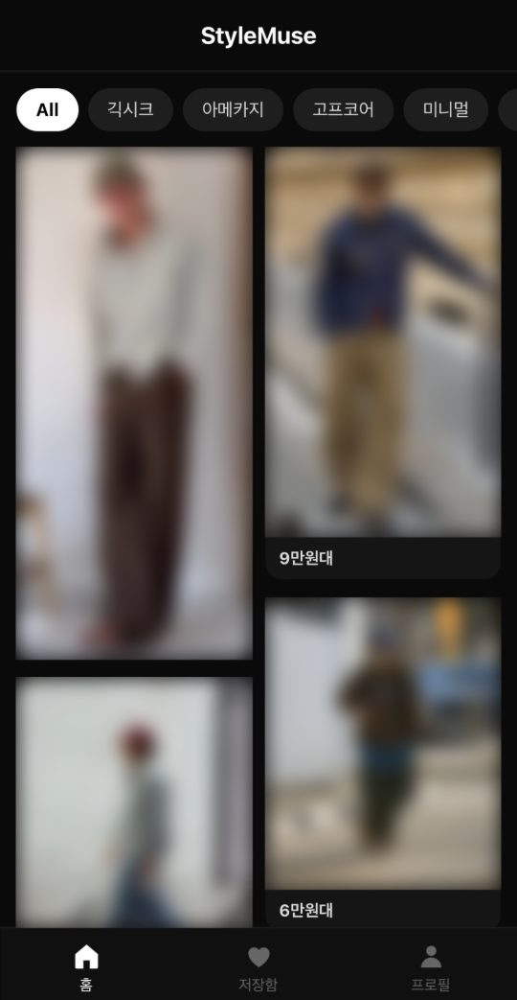
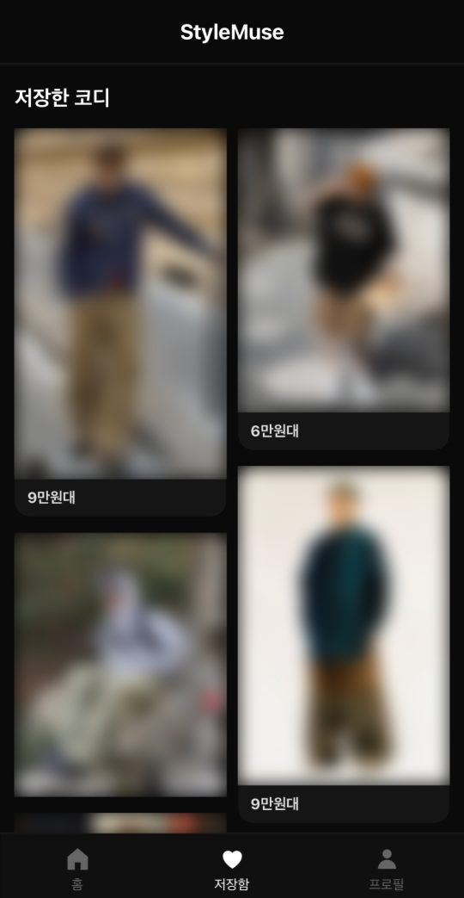
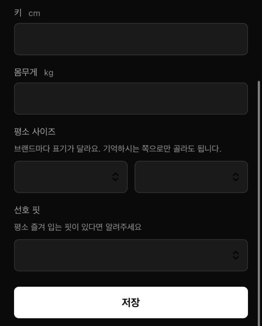
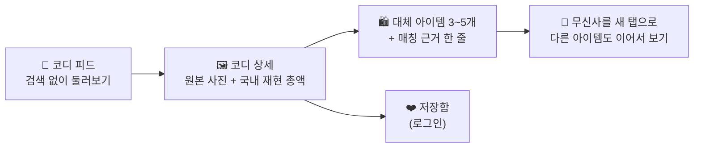
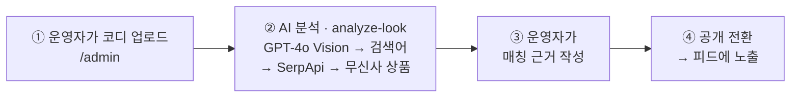

<div align="center">

# 🧥 StyleMuse

**핀터레스트에 저장해 둔 해외 코디를, 무신사에서 지금 살 수 있는 옷으로 바꿔 보여주는 모바일 웹 서비스**

> 해외 코디를 국내에서 살 수 있는 옷으로 **번역**한다.

`가설 검증용 프로토타입` · `모바일 웹(PWA)` · `Flask + Supabase`

[서비스 의도](docs/INTENT.md) · [화면·기능 명세](docs/SPEC.md) · [설계 결정](docs/DECISIONS.md) · [구현 이력](docs/prototype-changelog.md)

</div>

---

## 한눈에 보기

| | |
|---|---|
| **누구를 위해** | 핀터레스트·인스타에 코디를 저장해 두지만 실제 구매로는 거의 이어지지 않는 패션 입문 단계의 20대 초중반 남성 |
| **어떤 문제를** | 사진 속 옷은 비싸고, 어떤 국내 옷으로 바꿔야 그 느낌이 유지되는지 모른다. 사진 속 옷을 검색어로 옮길 어휘도 없다 |
| **어떻게 푸나** | 해외 코디마다 무신사에서 살 수 있는 대체 아이템 3~5개를 붙이고, 아이템마다 **"왜 이 옷인지" 매칭 근거 한 줄**을 함께 보여준다 |
| **무엇이 다른가** | 코디를 제안하는 국내 서비스는 모두 판매자라 자사 상품으로만 코디를 짠다. 해외 레퍼런스(핀터레스트)와 국내 구매를 잇는 서비스는 없다 |

## 화면

| 코디 피드 | 저장함 | 프로필 |
|---|---|---|
|  |  |  |
| 스타일 필터 + 2열 그리드. 카드마다 국내 재현 총액대를 보여준다 | 로그인하면 저장한 코디를 모아 본다 | 키·몸무게·사이즈·선호 핏. 모두 선택 입력 |

> 코디 사진은 핀터레스트·인스타그램 원본이라 저장소에는 흐리게 처리해서 넣었다. "원본 이미지는 자체 저장하지 않는다"는 설계 결정과 같은 이유다. 프로필 입력값은 비워 두었다. 실제 서비스에서는 원본 사진이 그대로 보인다.

## 이렇게 쓴다



1. **코디 피드** — 해외 코디를 2열 그리드로 둘러본다. 스타일 필터만 있고 검색창은 없다.
2. **코디 상세** — 원본 사진 → "이 코디, 국내 아이템으로" 재현 총액 → 대체 아이템 카드(상품명·판매처·가격·매칭 근거) 순서로 보여준다. 품절 아이템은 흐리게 두고 총액에서 뺀다.
3. **구매 이동** — 아이템을 누르면 무신사가 새 탭으로 열린다. 원래 화면이 남아 있어 나머지 아이템도 이어서 볼 수 있다.
4. **저장함·프로필** — 마음에 드는 코디를 저장한다(로그인 필요). 키·몸무게·사이즈·선호 핏을 선택해서 입력할 수 있다.

| 매칭 근거 예시 |
|---|
| ❌ 비슷한 느낌의 자켓 |
| ⭕ 오버핏 실루엣과 워싱 톤이 유사 |

매칭 근거에는 실루엣·소재·색상·기장 중 최소 하나를 명시한다.

## 설계 원칙

확정된 결정이다. 근거는 [DECISIONS.md](docs/DECISIONS.md)에 있다.

| 원칙 | 이유 |
|---|---|
| 검색창을 두지 않는다 | 이 서비스가 푸는 문제가 "검색어를 만들지 못한다"이다. 검색창은 그 문제를 유저에게 되돌려준다 |
| 매칭 근거를 반드시 함께 보여준다 | 대체품이 원본 분위기를 유지하는지 판단할 기준을 주기 위해서다 |
| 유저 화면에서 AI를 호출하지 않는다 | 수동 큐레이션이 전제다. 사람이 쓴 근거가 이후 자동화의 정답 데이터가 된다 |
| 무한 스크롤을 쓰지 않는다 | 구매 결정을 지연시킨다 |
| 원본 아이템의 브랜드명·가격을 표시하지 않는다 | 정확도를 확보할 수 없고 저작권 리스크가 있다 |
| 다크 테마, 이미지 중심 | 핀터레스트에서 들어오는 유저에게는 이미지가 주인공이다 |
| 앱 대신 모바일 우선 웹(PWA) | 스토어 심사 없이 배포할 수 있고, "설치"보다 "링크 클릭"의 진입 장벽이 낮다 |

새 기능을 판단하는 기준은 하나다. **"이것이 해외 코디를 국내 아이템으로 옮기는 일(번역)에 해당하는가."**

## 매칭은 이렇게 만든다 (운영)



- AI는 운영 화면에서만 쓴다. 유저 화면에서는 저장된 결과만 읽는다.
- 같은 검색어는 `search_cache`로 재사용해 외부 API 호출 비용을 줄인다.
- 정확도가 부족한 코디는 지우지 않고 비공개로 둔다.

## 지금 단계

- **가설 검증용 프로토타입**이다. 검증 결과에 따라 코드가 크게 바뀌거나 폐기될 수 있다. 프로덕션 품질보다 검증 속도를 우선한다.
- **북극성 지표**: 주간 코디 완성 시도 수. 한 코디에서 서로 다른 매칭 아이템을 2개 이상 구매 클릭한 세션 수를 센다.
- **문제 재정의 진행 중 (2026.09.14)**
  - 설문 25건에서 결제 직전 망설임 요인은 사이즈·핏 52%, 어울릴지 24%로, 합쳐서 76%였다.
  - "해외 코디 고유의 감성 수요"(가설 H10)는 기각됐다(해외 선호 20% < 국내 32%).
  - 그래서 문제를 "해외 코디를 못 산다"에서 **"이 옷이 나에게 어떻게 보일지 모른다"**로 옮기고 있다.
  - 그 전제로 로그인과 체형 프로필을 도입했다. `INTENT.md`의 문제·대상 서술은 다시 쓸 예정이다.

## 기술 구성

| 영역 | 기술 |
|---|---|
| 화면 | HTML + 바닐라 JS (Flask는 템플릿만 서빙). 다크 테마, 모바일 우선(앱 폭 480px), PWA |
| 데이터·인증 | Supabase(Postgres + RLS, Auth). 브라우저가 공개 키로 직접 조회한다 |
| AI 매칭 | Supabase Edge Function(Deno) `analyze-look`: OpenAI GPT-4o Vision + SerpApi |
| 키 관리 | OpenAI·SerpApi 키는 Supabase 시크릿에만 둔다. 브라우저에는 공개 키(publishable)만 간다 |

---

## 실행

```bash
python app.py          # http://127.0.0.1:5000
```

| 경로 | 화면 |
|---|---|
| `/` | 코디 피드 + 상세, 저장함, 프로필 |
| `/admin` | 코디 업로드·AI 분석 + 공개 상태 관리 + 매칭 근거 큐레이션 |
| `/notices` | 공지사항 (정적) |
| `/terms` | 이용약관 |
| `/privacy` | 개인정보처리방침 |

Flask는 HTML만 서빙한다. API 엔드포인트가 없고 DB에도 접근하지 않는다.
데이터 조회·쓰기는 브라우저가 Supabase로 직접 한다.

---

## 구조

```
app.py                              Flask 라우트 5개 (HTML 서빙만)
static/config.js                    SUPABASE_URL / SUPABASE_PUBLISHABLE_KEY (공개값만)
static/manifest.json, icons/        PWA (홈 화면 추가)
templates/
  index.html                        피드 + 상세 + 저장함 + 프로필 (라우팅 없이 show/hide)
  admin_upload.html                 업로드·분석 + 매칭 근거 큐레이션
  notice.html
  terms.html, privacy.html          법률 문서 (legal_base.html 공통 틀)
supabase/
  functions/analyze-look/index.ts   Edge Function (Deno)
  migrations/*.sql
docs/                               INTENT · SPEC · DECISIONS · prototype-changelog
.tools/                             supabase.exe, deno.exe (gitignore 대상)
```

### 데이터 모델

```
pinterest_looks (id, image_url, style_tag)
      │
      │  looks_items_match (look_id, item_id, original_type, match_reason)
      │      original_type : 원본 코디 속 아이템 유형 (브랜드명 제외)
      │      match_reason  : 매칭 근거 한 줄
      │      ↑ 둘 다 코디-상품 "관계"의 속성이라 musinsa_items 가 아니라 여기에 둔다.
      ↓        같은 상품이라도 붙는 코디가 다르면 근거가 달라진다.
musinsa_items (id, product_name, price, purchase_url, image_url, product_key, sold_out)
      product_key : 'musinsa:5909913' — purchase_url 의 추적 파라미터(srsltid)를 제거한 식별자

search_cache (query PK, item_id) : 검색어 → 상품. SerpApi 재호출 방지
```

유저 데이터(`user_profiles`, `saved_looks`, `user_agreements`)와 전체 테이블 목록은 [SPEC.md](docs/SPEC.md#데이터-구조)에 있다.

### AI 매칭 파이프라인 (`analyze-look`)

```
사진 → GPT-4o Vision → "{색상} {핏} {품목}" 검색어 (통제 어휘, temperature 0)
     → search_cache 조회 (적중 시 SerpApi 건너뜀)
     → SerpApi google_shopping → immersive product API → 무신사 직링크
     → musinsa_items upsert + looks_items_match 연결
```

브라우저는 OpenAI·SerpApi를 직접 호출하지 않는다. 키는 Supabase 시크릿에만 있다.

**`match_reason`·`original_type`은 AI가 생성하지 않는다.** 수동 큐레이션이 MVP의 전제이며,
사람이 쓴 근거가 이후 자동화의 정답 데이터가 된다. 입력은 `/admin`에서 한다.

---

## 보안 · 개인정보

### 배포 전 필수 조치

> **2026.09.15 — 해소 완료.** 서비스 성격을 "실제 서비스"로 바꾸면서
> 기존 보류 근거("학습 목적 개인 프로젝트, 외부 배포 계획 없음")가 무효가 되었고,
> 같은 날 조치를 끝냈다.

#### 완료

- [x] `pinterest_looks`, `looks_items_match`, `musinsa_items`에 RLS 적용
- [x] anon 키는 SELECT만 허용 (INSERT·UPDATE·DELETE 전면 차단)
- [x] `/admin`에 Supabase Auth 기반 인증 추가
- [x] 쓰기 작업은 운영자로 제한
- [x] `analyze-look` Edge Function 호출도 운영자로 제한
- [x] 유저 테이블 RLS (`user_profiles`, `saved_looks`, `user_agreements`)

#### 남은 항목

- [ ] **데모 계정 삭제** — `stylemuse.demo@gmail.com` (발표 시연용). 시연이 끝나면 지운다
- [ ] **HTTPS 확인** — 배포 후 실제 도메인에서 확인
- [ ] 내부 관리계획 문서 수립, 접근권한 정기 점검 절차

### 현재 RLS 상태

| 테이블 | 개인정보 | RLS | 읽기 | 쓰기 |
|---|---|---|---|---|
| `user_profiles` | ✅ | ✅ | 본인만 | 본인만 |
| `saved_looks` | ✅ | ✅ | 본인만 | 본인만 |
| `user_agreements` | ✅ | ✅ | 본인만 | 본인만 |
| `pinterest_looks` | ❌ | ✅ | 공개 코디 + 운영자 | 운영자만 |
| `looks_items_match` | ❌ | ✅ | 공개 코디의 매칭만 | 운영자만 |
| `musinsa_items` | ❌ | ✅ | 전체 | 운영자만 |
| `admin_users` | ❌ | ✅ | 정책 없음 = API 접근 불가 | SQL로만 |
| `search_cache` · `look_save_stats` | ❌ | ✅ | 정책 없음 = 서버 전용 | 서버 전용 |

**RLS 가 꺼진 테이블은 없다.**

### 관리자 권한

운영자는 `admin_users` 테이블로 관리한다. 이 테이블은 RLS 를 켜고 **정책을 하나도 두지 않아** API 로는 조회·추가·삭제가 모두 막혀 있다. 관리자 지정은 SQL 로만 가능하다.

`user_profiles.is_admin` 컬럼을 쓰지 않은 이유: 그 테이블에는 "본인 행은 본인이 수정한다" 정책이 있어 **이용자가 스스로를 운영자로 올릴 수 있다.** 컬럼 단위 권한 회수로 막을 수는 있으나, 보호막이 정책과 다른 곳에 숨어 나중에 `grant` 한 줄로 조용히 열릴 수 있다.

```bash
# 운영자 지정 (SQL 로만 가능)
.\.tools\supabase.exe db query --linked   "insert into admin_users (user_id, note) select id, '운영자' from auth.users where email = '<주소>'"
```

---

## ⚖️ 법률 문서

`/terms`(이용약관), `/privacy`(개인정보처리방침) — 각 v1.0, 2026.09.15 시행.

> **이 문서들은 법률 전문가의 검토를 받지 않은 초안입니다.**
> 실제 서비스 운영 전 전문가 검토를 권장합니다.
> 본문에서 확인이 필요한 부분은 `[확인 필요]`로 표시해 두었습니다.

작성 시 지킨 것:

- 수집 항목은 **실제 테이블 컬럼과 코드를 확인해** 작성했다. 추측하지 않았다
- 미구현 기능(전신 사진 업로드, Vertex AI 이전)은 **"도입 예정"으로 명시**하고 현재 수집·전송하지 않음을 밝혔다
- 안전성 확보조치는 **현재 상태를 있는 그대로** 적었다. 적용되지 않은 사항도 함께 기재했다

---

## 개발 도구

```bash
.\.tools\supabase.exe db query --linked "select ..."     # 원격 DB 조회
.\.tools\supabase.exe db query --linked -f 마이그레이션.sql
.\.tools\supabase.exe functions deploy analyze-look
.\.tools\supabase.exe secrets set --env-file <키만 담은 파일>
```

시크릿(`OPENAI_API_KEY`, `SERPAPI_KEY`)은 `.env`가 아니라 Supabase에 등록된 값이 실제로 쓰인다.
`.env`는 CLI로 옮기기 위한 출발점일 뿐이며, 앱 코드는 `.env`를 읽지 않는다.

---

## 알려진 제약

- **SerpApi 무료 플랜 250회/월.** 신규 코디 1건 분석에 5~9회 소모. 캐시 적중 시 0회
- **상세 화면에 URL이 없다.** 새로고침·뒤로가기·링크 공유 불가 (라우팅 미도입)
- **무신사 직접 크롤링 불가.** `robots.txt`가 `User-agent: * → Disallow: /`.
  공식 상품 API도 입점 브랜드용(주문 연동)뿐이라 제3자 상품 수집 경로가 없다.
  현재의 구글 경유는 무신사가 `Googlebot`에 허용한 정당한 경로다
- **텍스트 검색의 정확도 한계.** 색·품목을 검색어에 싣고 결과를 채점해도,
  시각 정보를 텍스트로 옮기는 과정에서 손실이 생긴다.
  근본 해결은 이미지 임베딩 검색이며 상품 카탈로그 확보가 선결 과제
